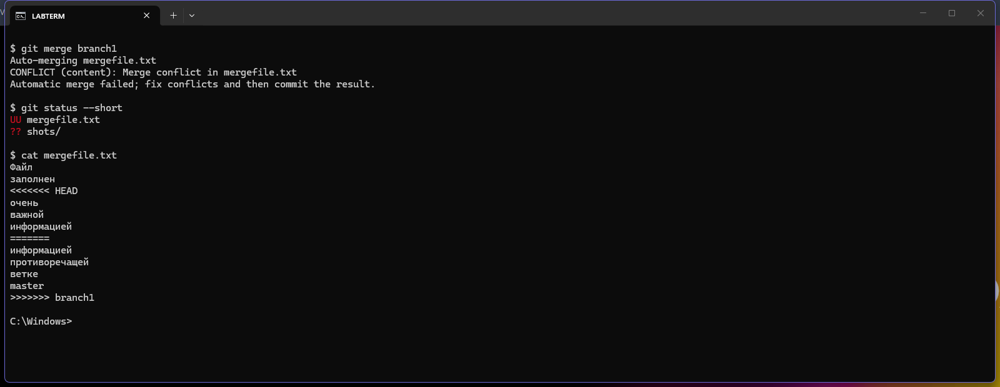
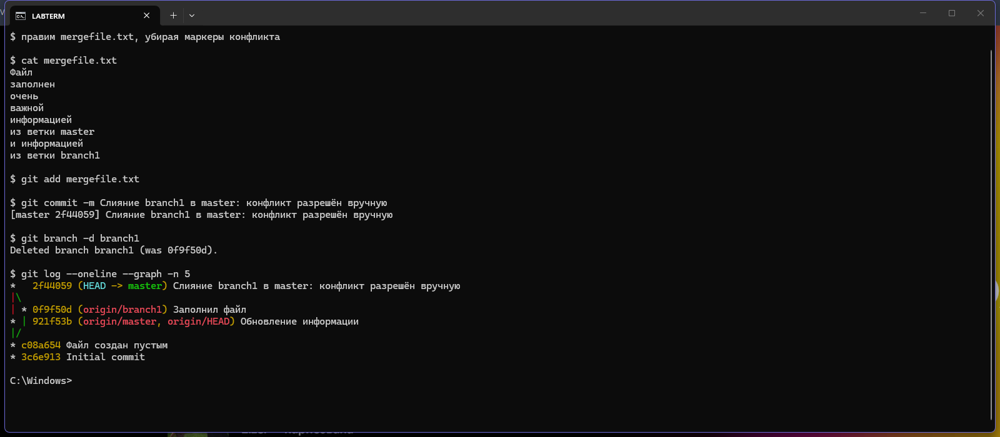
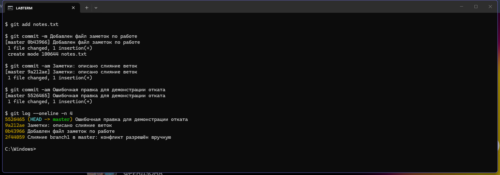
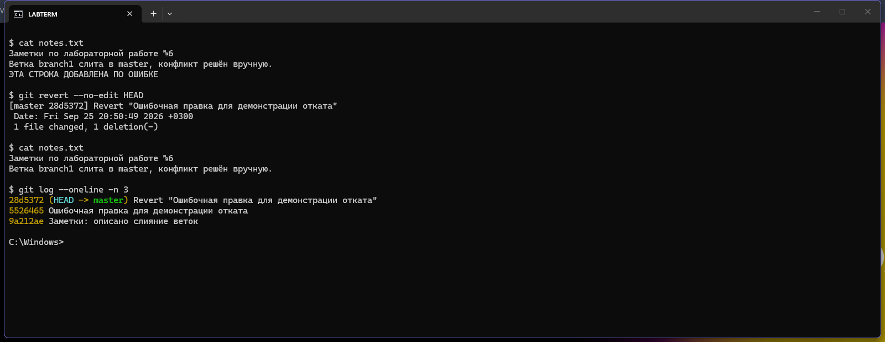
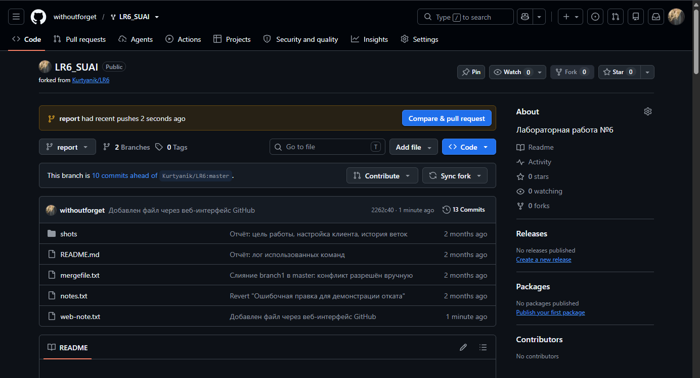

# Лабораторная работа №6. Система контроля версий

**Дисциплина:** основы программирования
**Студент:** гр. 4517 Тугушев Р.Д.

**Цель работы:** изучение базовых возможностей системы
управления версиями, опыт работы с Git API, опыт работы
с локальным и удалённым репозиторием.

Репозиторий получен форком из
[Kurtyanik/LR6](https://github.com/Kurtyanik/LR6).
Снимки экрана лежат в папке [`shots/`](shots).

## 1. Настройка клиента и клонирование

Git настроен локально для этого репозитория. Имя
пользователя задано в формате «Группа Фамилия И.О.»,
как требует методичка.

```
git config user.name "4517 Тугушев Р.Д."
git config user.email "idcfyoy@gmail.com"
```

После клонирования в репозитории один удалённый источник
`origin` и три коммита исходного автора.


## 2. История операций по каждой ветке

В репозитории две ветки: `master` и `branch1`. Они
разошлись после коммита `c08a654`, в котором файл
`mergefile.txt` был создан пустым. Дальше каждая ветка
заполнила его по-своему, поэтому слияние даст конфликт.

Команда `git log --oneline --graph --all` рисует обе ветки
сразу и показывает точку расхождения. Последние изменения
видны через `git show --stat`.


## 3. Слияние веток и разрешение конфликта

Слияние `branch1` в `master` останавливается на конфликте:
обе ветки переписали одни и те же строки `mergefile.txt`,
и git не может выбрать за меня. В файл он вставляет маркеры:
между `<<<<<<< HEAD` и `=======` лежит версия текущей ветки,
между `=======` и `>>>>>>> branch1` — версия входящей.



Конфликт разрешён вручную: я оставил обе формулировки,
пометив, откуда каждая пришла, и убрал маркеры. После
`git add` файл перестаёт быть конфликтным, и слияние
закрывается коммитом.



## 4. Удаление побочной ветки

После успешного слияния ветка `branch1` больше не нужна
и удалена командой `git branch -d branch1`. Ключ `-d`
в отличие от `-D` удаляет ветку только если она уже слита,
то есть защищает от потери коммитов.

## 5. Коммиты и откат

Сделано три последовательных коммита в файл `notes.txt`,
каждый со своим комментарием. Третий из них намеренно
ошибочный.



Ошибочный коммит откачен через `git revert`. Эта команда
не стирает историю, а создаёт новый коммит с обратными
изменениями, поэтому она безопасна для уже отправленной
в общий репозиторий работы. Видно, что строка из файла
исчезла, а оба коммита — и ошибочный, и отменяющий его —
остались в истории.



## 6. Добавление файла через сайт GitHub

В ветке `report` через веб-интерфейс GitHub создан файл
`web-note.txt`, коммит `2262c40`. Затем локальная копия
обновлена командой `git pull --ff-only origin report`.
Получен один новый коммит и файл из двух строк. Ключ
`--ff-only` разрешает только перемотку ветки вперёд,
чтобы получение файла не создало лишний коммит слияния.



Этот шаг выполнен после остальных операций с ветками;
его место в истории видно по дате и хэшу коммита.

## 7. Лог команд

Команды приведены без результатов выполнения, в том
порядке, в котором применялись.

```
git clone git@github.com:withoutforget/LR6_SUAI.git
cd LR6_SUAI
git config user.name "4517 Тугушев Р.Д."
git config user.email "idcfyoy@gmail.com"
git config --local --get user.name
git config --local --get user.email
git remote -v
git log --oneline -n 4

git checkout -b branch1 origin/branch1
git checkout master
git branch -a
git log --oneline --graph --all
git log --oneline branch1
git show --stat HEAD

git merge branch1
git status --short
cat mergefile.txt
git add mergefile.txt
git commit -m "Слияние branch1 в master: конфликт разрешён вручную"
git branch -d branch1
git log --oneline --graph -n 5

git add notes.txt
git commit -m "Добавлен файл заметок по работе"
git commit -am "Заметки: описано слияние веток"
git commit -am "Ошибочная правка для демонстрации отката"
git log --oneline -n 4
git revert --no-edit HEAD

git checkout -b report
git add README.md shots
git commit -m "Отчёт: цель работы, настройка клиента, история веток"
git commit -m "Отчёт: слияние с конфликтом, удаление ветки, откат коммита"
git commit -m "Отчёт: лог использованных команд"
git log --pretty=format:"%h %ad %an %s" --date=short
git push origin master
git push origin report
git pull --ff-only origin report
git show --stat 2262c40
git log --pretty=format:"%h %ad %an %s" --date=short
git add README.md shots/07-github.png
git commit -m "Отчёт: файл через GitHub и история операций"
git push origin report
```

## 8. Форматированная история операций

История получена перед финальной фиксацией отчёта.
Финальная фиксация добавляет этот раздел и снимок GitHub;
её хэш появляется в `git log` после сохранения.

```
2262c40 2026-11-05 Roman Kovach Добавлен файл через веб-интерфейс GitHub
136424c 2026-09-25 4517 Тугушев Р.Д. Отчёт: лог использованных команд
f10d21f 2026-09-25 4517 Тугушев Р.Д. Отчёт: слияние с конфликтом, удаление ветки, откат коммита
6e25589 2026-09-25 4517 Тугушев Р.Д. Отчёт: цель работы, настройка клиента, история веток
28d5372 2026-09-25 4517 Тугушев Р.Д. Revert "Ошибочная правка для демонстрации отката"
5526465 2026-09-25 4517 Тугушев Р.Д. Ошибочная правка для демонстрации отката
9a212ae 2026-09-25 4517 Тугушев Р.Д. Заметки: описано слияние веток
0b43966 2026-09-25 4517 Тугушев Р.Д. Добавлен файл заметок по работе
2f44059 2026-09-25 4517 Тугушев Р.Д. Слияние branch1 в master: конфликт разрешён вручную
921f53b 2020-11-21 Kurtyanik Обновление информации
0f9f50d 2020-11-21 Kurtyanik Заполнил файл
c08a654 2020-11-21 Kurtyanik Файл создан пустым
3c6e913 2020-11-21 Kurtyanik Initial commit
```
