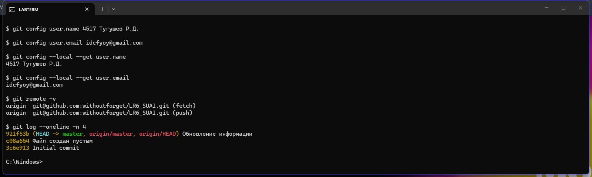
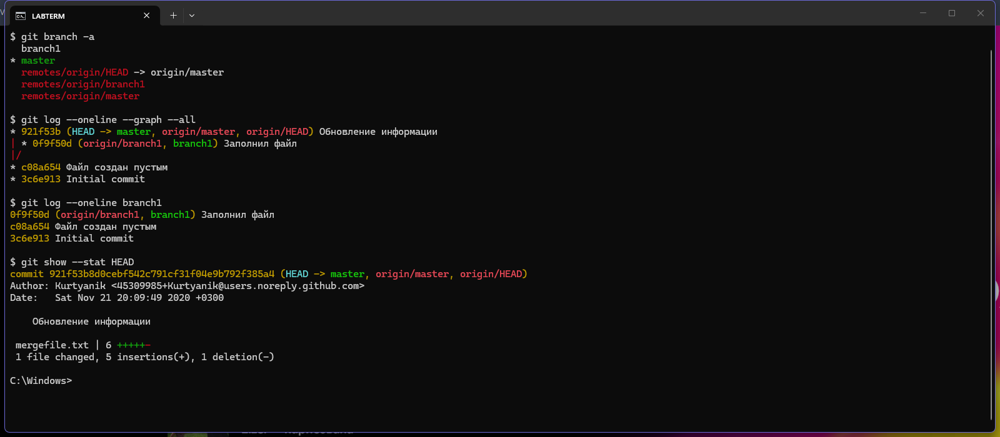

# Лабораторная работа №6. Система контроля версий

**Дисциплина:** основы программирования
**Студент:** гр. 4517 Тугушев Р.Д.

**Цель работы:** изучение базовых возможностей системы
управления версиями, опыт работы с Git API, опыт работы
с локальным и удалённым репозиторием.

Репозиторий получен форком из
[Kurtyanik/LR6](https://github.com/Kurtyanik/LR6).
Снимки экрана лежат в папке [`shots/`](shots).

## 1. Настройка клиента и клонирование

Git настроен локально для этого репозитория. Имя
пользователя задано в формате «Группа Фамилия И.О.»,
как требует методичка.

```
git config user.name "4517 Тугушев Р.Д."
git config user.email "idcfyoy@gmail.com"
```

После клонирования в репозитории один удалённый источник
`origin` и три коммита исходного автора.



## 2. История операций по каждой ветке

В репозитории две ветки: `master` и `branch1`. Они
разошлись после коммита `c08a654`, в котором файл
`mergefile.txt` был создан пустым. Дальше каждая ветка
заполнила его по-своему, поэтому слияние даст конфликт.

Команда `git log --oneline --graph --all` рисует обе ветки
сразу и показывает точку расхождения. Последние изменения
видны через `git show --stat`.


